# Práctica 1.6 · Instalación de WordPress en una instancia EC2 de AWS

**Despliegue de Aplicaciones Web · 2º DAW · Curso 2026/2027**
**Alumno:** Francisco López Lobanova · GitHub: [Frxnker](https://github.com/Frxnker)

En esta práctica se instala el CMS **WordPress** en una instancia EC2 de AWS con Ubuntu Server. Todo el proceso está automatizado con scripts de Bash: instalación de la pila LAMP, certificado HTTPS de Let's Encrypt y despliegue de WordPress de dos formas distintas:

1. En el **directorio raíz** de Apache (`/var/www/html`).
2. En su **propio directorio** (`/var/www/html/wordpress`), pero mostrando el sitio en la raíz del dominio.

**Sitio desplegado:** [https://fran-https.ddns.net](https://fran-https.ddns.net)

---

## Índice

- [Práctica 1.6 · Instalación de WordPress en una instancia EC2 de AWS](#práctica-16--instalación-de-wordpress-en-una-instancia-ec2-de-aws)
  - [Índice](#índice)
  - [1. Conceptos básicos](#1-conceptos-básicos)
  - [2. Creación de la instancia](#2-creación-de-la-instancia)
    - [Grupo de seguridad](#grupo-de-seguridad)
    - [IP elástica](#ip-elástica)
  - [3. Estructura del repositorio](#3-estructura-del-repositorio)
  - [4. Variables de configuración (.env)](#4-variables-de-configuración-env)
  - [5. Instalación de LAMP y HTTPS](#5-instalación-de-lamp-y-https)
  - [6. Configuración de Apache para WordPress](#6-configuración-de-apache-para-wordpress)
    - [6.1. AllowOverride All](#61-allowoverride-all)
    - [6.2. Enlaces permanentes (.htaccess)](#62-enlaces-permanentes-htaccess)
  - [7. WordPress en el directorio raíz](#7-wordpress-en-el-directorio-raíz)
    - [7.1. Descarga](#71-descarga)
    - [7.2. Base de datos](#72-base-de-datos)
    - [7.3. wp-config.php](#73-wp-configphp)
    - [7.4. Claves de seguridad](#74-claves-de-seguridad)
    - [7.5. Enlaces permanentes y propietario](#75-enlaces-permanentes-y-propietario)
    - [7.6. Comprobación](#76-comprobación)
  - [8. WordPress en su propio directorio](#8-wordpress-en-su-propio-directorio)
    - [8.1. Se mueve la carpeta completa](#81-se-mueve-la-carpeta-completa)
    - [8.2. WP\_SITEURL y WP\_HOME](#82-wp_siteurl-y-wp_home)
    - [8.3. index.php en la raíz](#83-indexphp-en-la-raíz)
    - [8.4. .htaccess en la raíz](#84-htaccess-en-la-raíz)
    - [8.5. Comprobación](#85-comprobación)
  - [9. Cómo reproducir el despliegue](#9-cómo-reproducir-el-despliegue)
  - [Referencias](#referencias)

---

## 1. Conceptos básicos

| Concepto | Descripción |
|---|---|
| **AWS** | Plataforma de computación en la nube de Amazon. Se usa el servicio EC2 para crear la máquina virtual |
| **CMS** | Sistema de gestión de contenidos: software para crear, editar y publicar el contenido de una web sin programar. Ejemplos: WordPress, Joomla, Drupal |
| **WordPress** | CMS libre y gratuito escrito en PHP que guarda su contenido en MySQL. Tiene miles de temas y plugins |

---

## 2. Creación de la instancia

| Parámetro | Valor |
|---|---|
| Nombre | `Practica01-06` |
| Región | `us-east-1` (Norte de Virginia) |
| AMI | Ubuntu Server 26.04 LTS |
| Tipo de instancia | `t3.large` |
| Par de claves | `vockey` |
| IP elástica | `52.70.117.247` |
| Dominio | `fran-https.ddns.net` (No-IP) |

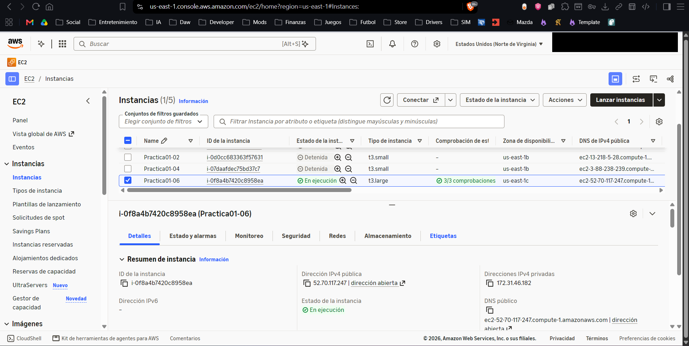

### Grupo de seguridad

| Puerto | Protocolo | Uso |
|---|---|---|
| 22 | TCP | SSH |
| 80 | TCP | HTTP (reto de Let's Encrypt y redirección a HTTPS) |
| 443 | TCP | HTTPS |

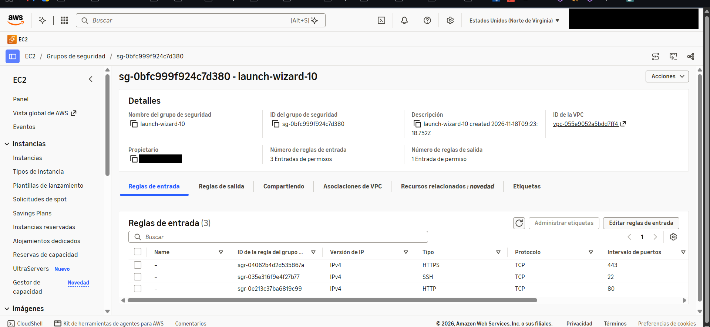

### IP elástica

Se reutiliza la IP elástica de la práctica 1.5. Se desasocia de la instancia anterior y se asocia a esta, de modo que el dominio `fran-https.ddns.net` sigue apuntando al servidor sin tener que cambiar el registro DNS en No-IP.

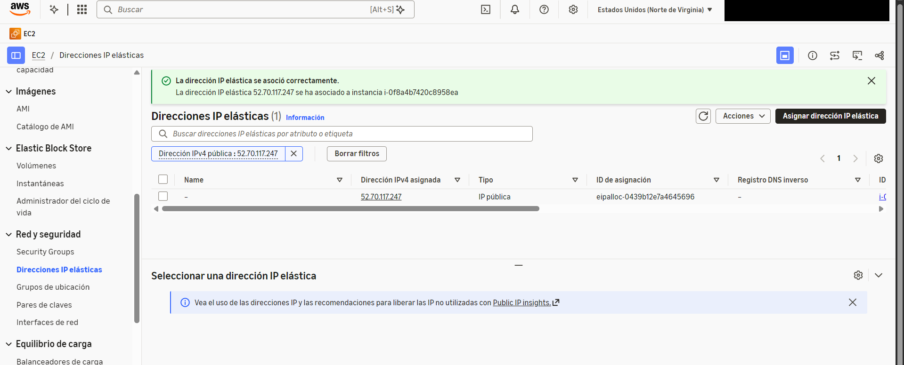

---

## 3. Estructura del repositorio

```
.
├── README.md
├── .gitignore
├── .gitattributes
├── conf
│   └── 000-default.conf
├── htaccess
│   └── .htaccess
├── img
└── scripts
    ├── .env.example
    ├── install_lamp.sh
    ├── setup_letsencrypt_https.sh
    ├── deploy_wordpress_root_directory.sh
    └── deploy_wordpress_own_directory.sh
```

| Archivo | Función |
|---|---|
| `conf/000-default.conf` | VirtualHost del puerto 80 con `ServerName` y `AllowOverride All` |
| `htaccess/.htaccess` | Reglas de `mod_rewrite` para los enlaces permanentes de WordPress |
| `scripts/install_lamp.sh` | Instala Apache, PHP y MySQL |
| `scripts/setup_letsencrypt_https.sh` | Obtiene un certificado de Let's Encrypt con Certbot y activa HTTPS |
| `scripts/deploy_wordpress_root_directory.sh` | Instala WordPress en `/var/www/html` |
| `scripts/deploy_wordpress_own_directory.sh` | Instala WordPress en `/var/www/html/wordpress` |
| `scripts/.env.example` | Plantilla de las variables de configuración |
| `.gitattributes` | Fuerza saltos de línea LF para que los scripts funcionen en Linux aunque se editen en Windows |

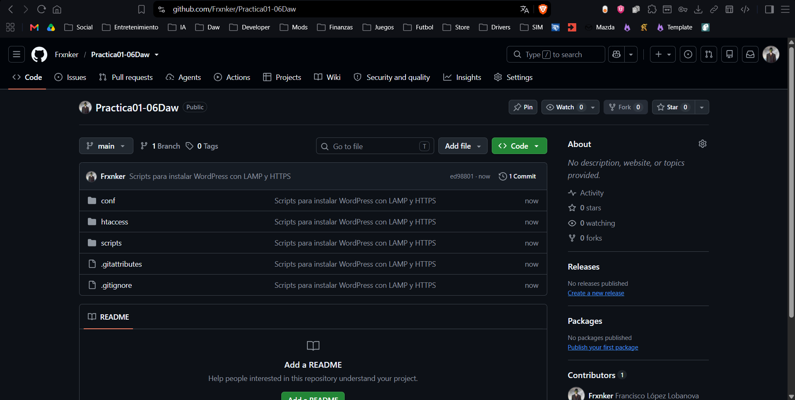

---

## 4. Variables de configuración (.env)

Las variables se guardan en `scripts/.env`, que no se sube al repositorio (está en `.gitignore`).

```
WORDPRESS_DB_NAME=wordpress
WORDPRESS_DB_USER=wp_user
WORDPRESS_DB_PASSWORD=********
WORDPRESS_DB_HOST=localhost
IP_CLIENTE_MYSQL=localhost
CERTIFICATE_EMAIL=tu_email@ejemplo.com
CERTIFICATE_DOMAIN=fran-https.ddns.net
```

| Variable | Uso |
|---|---|
| `WORDPRESS_DB_NAME` | Nombre de la base de datos de WordPress |
| `WORDPRESS_DB_USER` | Usuario de MySQL que usa WordPress |
| `WORDPRESS_DB_PASSWORD` | Contraseña de ese usuario |
| `WORDPRESS_DB_HOST` | Dónde está MySQL, visto desde WordPress |
| `IP_CLIENTE_MYSQL` | Desde dónde puede conectarse el usuario a MySQL |
| `CERTIFICATE_EMAIL` | Email para los avisos de Let's Encrypt |
| `CERTIFICATE_DOMAIN` | Dominio del certificado y del sitio |

`WORDPRESS_DB_HOST` e `IP_CLIENTE_MYSQL` valen `localhost` porque WordPress y MySQL están en la misma máquina. Si estuvieran en máquinas distintas, `IP_CLIENTE_MYSQL` podría ser:

| Valor | Significado |
|---|---|
| `localhost` | Solo desde el propio servidor |
| `%` | Desde cualquier IP |
| `172.31.80.67` | Solo desde esa IP |
| `172.31.%` | Desde cualquier IP de esa red |

La contraseña debe tener solo letras y números: caracteres como `/`, `&` o `'` romperían los comandos `sed` y `mysql` de los scripts.

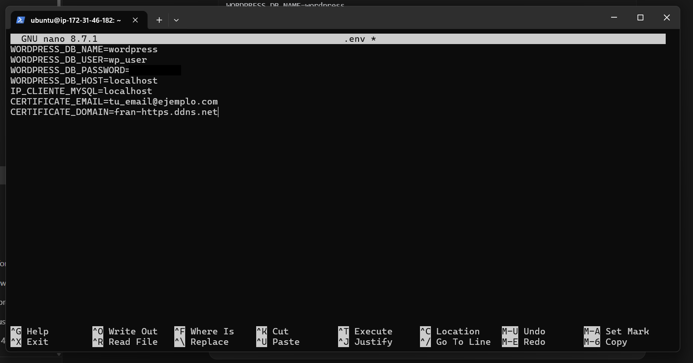

---

## 5. Instalación de LAMP y HTTPS

```bash
ssh -i vockey.pem ubuntu@52.70.117.247
git clone https://github.com/Frxnker/Practica01-06Daw.git
cd Practica01-06Daw/scripts
cp .env.example .env
nano .env
chmod +x *.sh
sudo ./install_lamp.sh
sudo ./setup_letsencrypt_https.sh
```

`install_lamp.sh` es el mismo de las prácticas anteriores: instala Apache (con `mod_rewrite`), PHP y MySQL Server.

`setup_letsencrypt_https.sh` es el script de la práctica 1.5: pone el dominio en el `ServerName`, instala Certbot con `snap` y pide el certificado en modo no interactivo. Certbot crea el VirtualHost HTTPS y añade la redirección de HTTP a HTTPS.

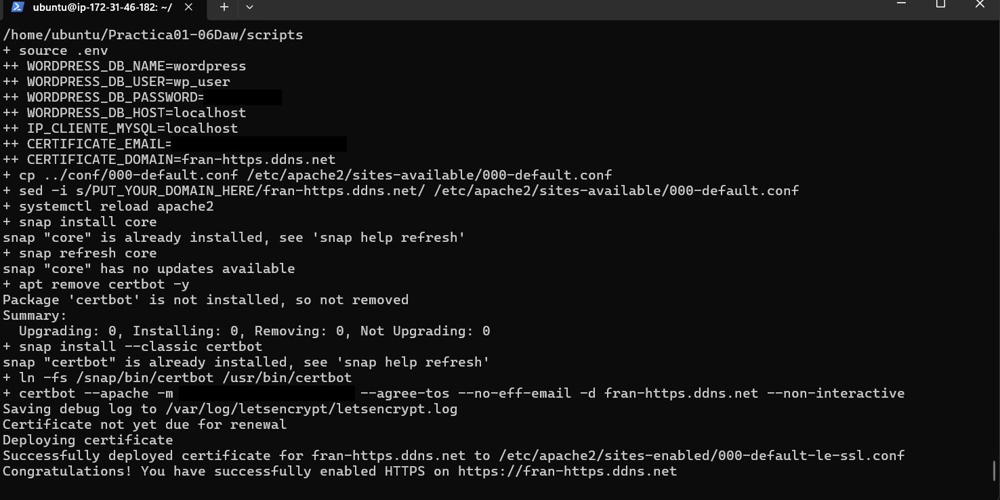

```bash
curl -I http://fran-https.ddns.net
```

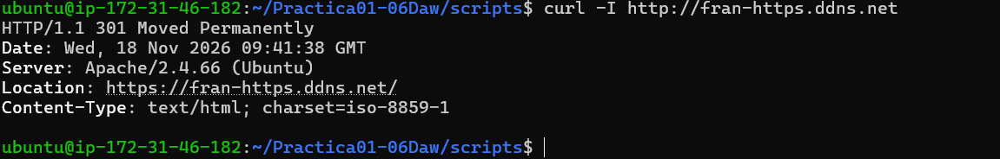

---

## 6. Configuración de Apache para WordPress

### 6.1. AllowOverride All

`conf/000-default.conf` añade un bloque `<Directory>` con `AllowOverride All`. Por defecto Apache ignora los archivos `.htaccess`; con esta directiva los tiene en cuenta, y WordPress los necesita para los enlaces permanentes. Certbot copia este bloque al VirtualHost HTTPS que genera.

```apache
<VirtualHost *:80>
    ServerName PUT_YOUR_DOMAIN_HERE
    DocumentRoot /var/www/html
    DirectoryIndex index.php index.html

    <Directory /var/www/html>
        AllowOverride All
    </Directory>
</VirtualHost>
```

### 6.2. Enlaces permanentes (.htaccess)

WordPress muestra por defecto URLs como `/?p=123`. Para usar URLs legibles como `/hola-mundo/` se usa este `.htaccess`, que se copia a `/var/www/html`:

```apache
# BEGIN WordPress
<IfModule mod_rewrite.c>
RewriteEngine On
RewriteBase /
RewriteRule ^index\.php$ - [L]
RewriteCond %{REQUEST_FILENAME} !-f
RewriteCond %{REQUEST_FILENAME} !-d
RewriteRule . /index.php [L]
</IfModule>
# END WordPress
```

| Directiva | Función |
|---|---|
| `RewriteEngine On` | Activa `mod_rewrite` |
| `RewriteBase /` | Las reglas se aplican desde la raíz del sitio |
| `RewriteRule ^index\.php$ - [L]` | Si se pide `index.php` directamente, no se reescribe |
| `RewriteCond %{REQUEST_FILENAME} !-f` | Solo si la URL no corresponde a un archivo real… |
| `RewriteCond %{REQUEST_FILENAME} !-d` | …ni a un directorio real… |
| `RewriteRule . /index.php [L]` | …se pasa la petición a `index.php`, y WordPress decide qué mostrar |

---

## 7. WordPress en el directorio raíz

Script: `scripts/deploy_wordpress_root_directory.sh`

```bash
sudo ./deploy_wordpress_root_directory.sh
```

### 7.1. Descarga

```bash
rm -rf /tmp/latest.tar.gz /tmp/wordpress
wget https://wordpress.org/latest.tar.gz -P /tmp
tar -xzvf /tmp/latest.tar.gz -C /tmp
rm -rf /var/www/html/*
mv -f /tmp/wordpress/* /var/www/html
```

Se descarga la última versión de WordPress en `/tmp`, se vacía el directorio web y se mueve allí **el contenido** de la carpeta `wordpress`.

### 7.2. Base de datos

```bash
mysql -u root <<< "DROP DATABASE IF EXISTS $WORDPRESS_DB_NAME"
mysql -u root <<< "CREATE DATABASE $WORDPRESS_DB_NAME"
mysql -u root <<< "DROP USER IF EXISTS $WORDPRESS_DB_USER@$IP_CLIENTE_MYSQL"
mysql -u root <<< "CREATE USER $WORDPRESS_DB_USER@$IP_CLIENTE_MYSQL IDENTIFIED BY '$WORDPRESS_DB_PASSWORD'"
mysql -u root <<< "GRANT ALL PRIVILEGES ON $WORDPRESS_DB_NAME.* TO $WORDPRESS_DB_USER@$IP_CLIENTE_MYSQL"
```

Se crea la base de datos y un usuario con permisos solo sobre ella. Los `DROP ... IF EXISTS` permiten ejecutar el script varias veces sin errores. `<<<` (*here string*) pasa la sentencia SQL a `mysql` como entrada.

### 7.3. wp-config.php

```bash
cp /var/www/html/wp-config-sample.php /var/www/html/wp-config.php
sed -i "s/database_name_here/$WORDPRESS_DB_NAME/" /var/www/html/wp-config.php
sed -i "s/username_here/$WORDPRESS_DB_USER/" /var/www/html/wp-config.php
sed -i "s/password_here/$WORDPRESS_DB_PASSWORD/" /var/www/html/wp-config.php
sed -i "s/localhost/$WORDPRESS_DB_HOST/" /var/www/html/wp-config.php
```

Se parte de la plantilla `wp-config-sample.php` y se sustituyen con `sed` los valores de ejemplo por los del `.env`. Así el asistente de instalación ya no pide los datos de la base de datos.

### 7.4. Claves de seguridad

```bash
sed -i "/AUTH_KEY/d" /var/www/html/wp-config.php
sed -i "/SECURE_AUTH_KEY/d" /var/www/html/wp-config.php
sed -i "/LOGGED_IN_KEY/d" /var/www/html/wp-config.php
sed -i "/NONCE_KEY/d" /var/www/html/wp-config.php
sed -i "/AUTH_SALT/d" /var/www/html/wp-config.php
sed -i "/SECURE_AUTH_SALT/d" /var/www/html/wp-config.php
sed -i "/LOGGED_IN_SALT/d" /var/www/html/wp-config.php
sed -i "/NONCE_SALT/d" /var/www/html/wp-config.php
SECURITY_KEYS=$(curl https://api.wordpress.org/secret-key/1.1/salt/)
SECURITY_KEYS=$(echo $SECURITY_KEYS | tr / _)
sed -i "/@-/a $SECURITY_KEYS" /var/www/html/wp-config.php
```

WordPress usa estas ocho claves para firmar las cookies de sesión. La plantilla trae valores de ejemplo, así que se borran y se sustituyen por claves aleatorias que genera la API de WordPress. Las `/` se cambian por `_` porque `sed` las confundiría con su separador. Las nuevas claves se insertan después de la línea que contiene `@-`, que es donde estaban las originales.

### 7.5. Enlaces permanentes y propietario

```bash
cp ../htaccess/.htaccess /var/www/html/
a2enmod rewrite
systemctl restart apache2
chown -R www-data:www-data /var/www/html/
```

Los archivos pasan a ser de `www-data`, el usuario de Apache, para que WordPress pueda subir imágenes e instalar temas y plugins.

### 7.6. Comprobación

Al abrir `https://fran-https.ddns.net` aparece el asistente de instalación, donde se eligen el idioma, el título del sitio y el usuario administrador:

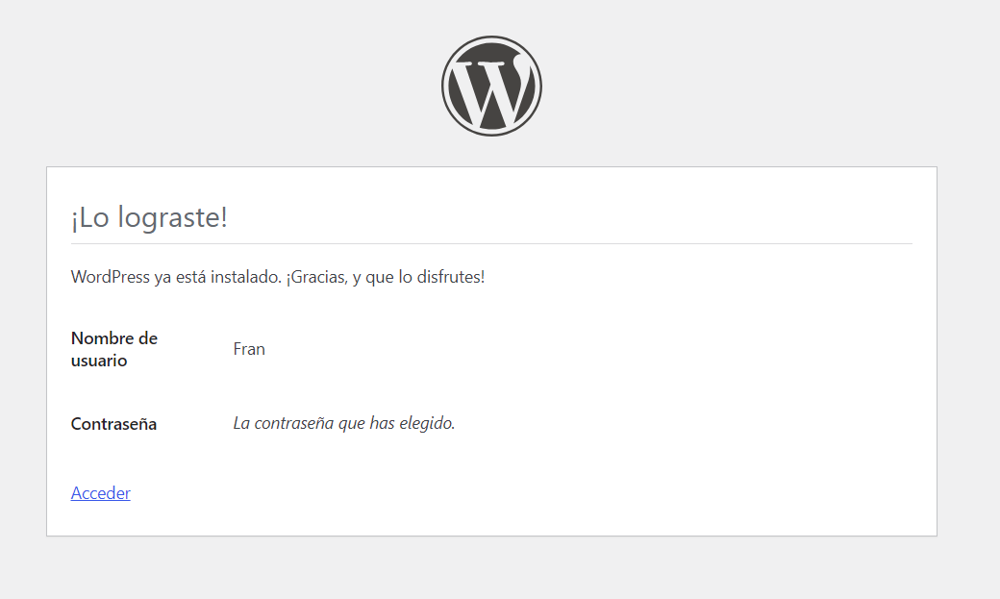


En **Ajustes → Enlaces permanentes** se elige **Nombre de la entrada**. La entrada de ejemplo carga en `/hola-mundo/`, lo que confirma que el `.htaccess` y `AllowOverride All` funcionan:

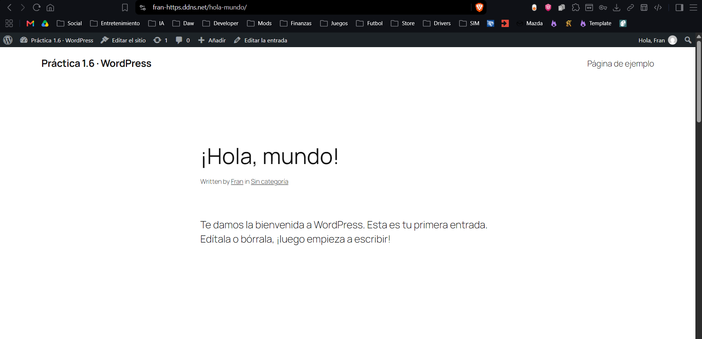

---

## 8. WordPress en su propio directorio

Script: `scripts/deploy_wordpress_own_directory.sh`

```bash
sudo ./deploy_wordpress_own_directory.sh
```

Los archivos de WordPress quedan en `/var/www/html/wordpress`, separados de la raíz del servidor, pero el sitio se sigue viendo en `https://fran-https.ddns.net`, sin `/wordpress` en la URL.

Los pasos son los mismos que en la instalación en la raíz, con estas diferencias:

### 8.1. Se mueve la carpeta completa

```bash
mv -f /tmp/wordpress /var/www/html
```

Y todas las rutas de `wp-config.php` apuntan a `/var/www/html/wordpress/`.

### 8.2. WP_SITEURL y WP_HOME

```bash
sed -i "/DB_COLLATE/a define('WP_SITEURL', 'https://$CERTIFICATE_DOMAIN/wordpress');" /var/www/html/wordpress/wp-config.php
sed -i "/WP_SITEURL/a define('WP_HOME', 'https://$CERTIFICATE_DOMAIN');" /var/www/html/wordpress/wp-config.php
```

| Constante | Valor | Significado |
|---|---|---|
| `WP_SITEURL` | `https://fran-https.ddns.net/wordpress` | Dónde están los archivos de WordPress (incluido el panel `wp-admin`) |
| `WP_HOME` | `https://fran-https.ddns.net` | La URL pública del sitio, la que ven los visitantes |

### 8.3. index.php en la raíz

```bash
cp /var/www/html/wordpress/index.php /var/www/html
sed -i "s#wp-blog-header.php#wordpress/wp-blog-header.php#" /var/www/html/index.php
```

Se copia `index.php` a la raíz y se cambia la ruta del archivo que carga WordPress. Así, al entrar en la raíz del dominio se ejecuta WordPress desde su carpeta. En este `sed` se usa `#` como separador en lugar de `/`, porque la ruta contiene `/`.

### 8.4. .htaccess en la raíz

El `.htaccess` se copia a `/var/www/html`, no dentro de `/wordpress`, porque las URLs públicas del sitio cuelgan de la raíz.

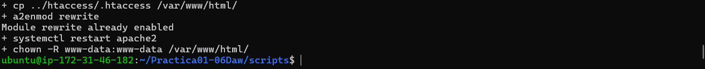

### 8.5. Comprobación

```bash
ls -a /var/www/html
ls /var/www/html/wordpress
grep -E "WP_SITEURL|WP_HOME" /var/www/html/wordpress/wp-config.php
```

En la raíz solo quedan `.htaccess`, `index.php` y la carpeta `wordpress`:

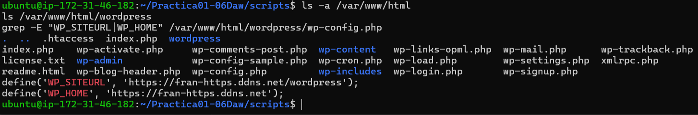

El panel de administración está ahora en `/wordpress/wp-admin/`:

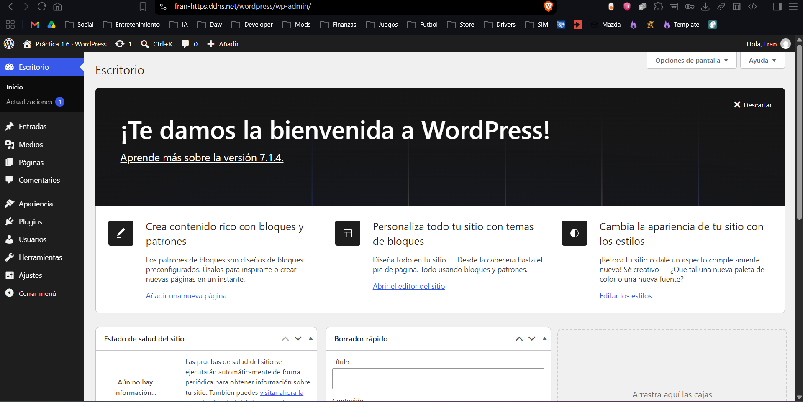

Pero la portada se sirve en la raíz del dominio:

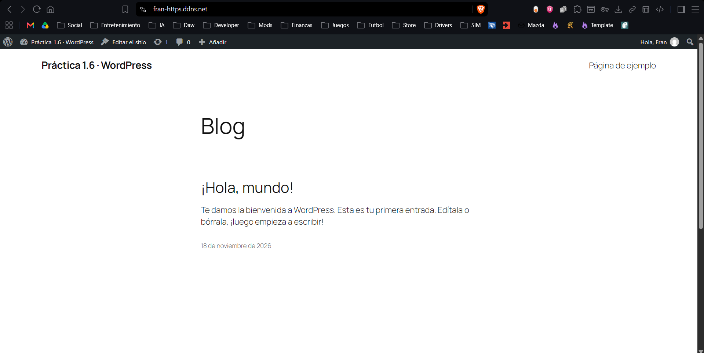

Se vuelven a configurar los enlaces permanentes (**Nombre de la entrada**):

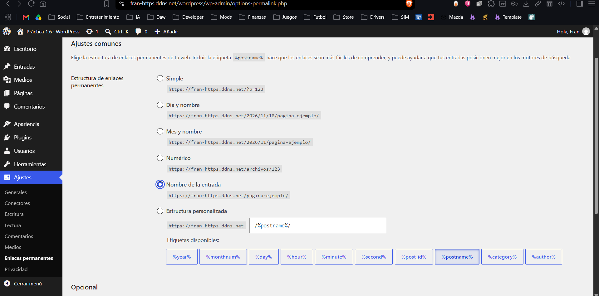

Y la entrada de ejemplo carga en `/hola-mundo/`, sin `/wordpress` en la URL:

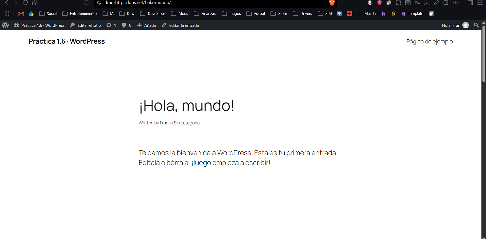

---

## 9. Cómo reproducir el despliegue

Requisitos: una instancia Ubuntu Server con los puertos 22, 80 y 443 abiertos y un dominio con un registro A que apunte a su IP.

```bash
git clone https://github.com/Frxnker/Practica01-06Daw.git
cd Practica01-06Daw/scripts
cp .env.example .env
nano .env
chmod +x *.sh
sudo ./install_lamp.sh
sudo ./setup_letsencrypt_https.sh

# Una de las dos:
sudo ./deploy_wordpress_root_directory.sh
sudo ./deploy_wordpress_own_directory.sh
```

> Los dos scripts de WordPress vacían `/var/www/html` y recrean la base de datos, así que cada uno elimina la instalación anterior.
>
> Los scripts usan rutas relativas (`../conf`, `../htaccess`), así que deben ejecutarse desde dentro de la carpeta `scripts`.

---

## Referencias

- [Enunciado de la práctica](https://josejuansanchez.org/iaw/practica-01-06/index.html)
- [WordPress](https://wordpress.org)
- [Dar a WordPress su propio directorio](https://developer.wordpress.org/advanced-administration/server/wordpress-in-directory/)
- [API de claves de seguridad de WordPress](https://api.wordpress.org/secret-key/1.1/salt/)
- [Certbot · Instrucciones para Apache](https://certbot.eff.org/instructions?ws=apache&os=snap)
- [Módulo mod_rewrite de Apache](https://httpd.apache.org/docs/current/mod/mod_rewrite.html)